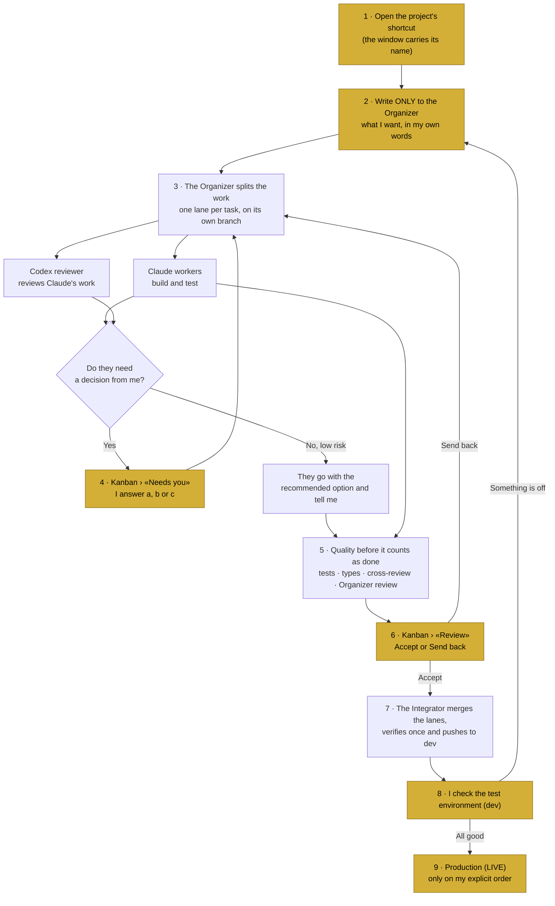

# Hi, I’m Vlad Cioca 👋

## Who am I?

I’m the CEO at SAVA Logistic, based in Castellar del Vallès. Background in Business Administration (logistics focus) and hands-on experience leading international transport operations, customer retention, and issue resolution in the logistics sector. 

## What am I currently working on?

* Building and scaling **n8n automations** (agentic workflows, ops + marketing pipelines, reporting, and integrations).

## What tools do I use?

* **Automation / Agents:** n8n, Antigravity
* **Dev:** Visual Studio Code
* **LLMs:** Claude, Gemini
* **Data / Backend:** Supabase
* **Ops stack:** Google Workspace

## How to reach me

* **WhatsApp:** [+34627259871](https://wa.me/34627259871)
* **Email:** [vlad.cioca@savaexpress.com](mailto:vlad.cioca@savaexpress.com)

<!--
**xRyUxSama/xRyUxSama** is a ✨ _special_ ✨ repository because its `README.md` (this file) appears on your GitHub profile.

Here are some ideas to get you started:

- 🔭 I’m currently working on ...
- 🌱 I’m currently learning ...
- 👯 I’m looking to collaborate on ...
- 🤔 I’m looking for help with ...
- 💬 Ask me about ...
- 📫 How to reach me: ...
- 😄 Pronouns: ...
- ⚡ Fun fact: ...
-->

## 🧭 How I work with AgentMux (many AIs, one chat)

Each project opens in its own AgentMux window. I only talk to its **Organizer**: it splits the work between the AIs
(Claude builds, Codex reviews), asks me through the Kanban, and nothing reaches production without my say-so.

Gold steps are mine. Everything else is done by the agents.

**What I use every day**

| I need to | Where |
|---|---|
| Talk to the project | the Organizer's pane, and only that one |
| See what they're asking me | **Kanban** in the top bar, «Needs you» column |
| See every agent at a glance | **Swarm** (also to message several at once) |
| Keep them from stopping at every step | **Supervisor** set to *Steady* for the Organizers |
| Dictate instead of typing | `Ctrl+Shift+V` (local: the audio never leaves the PC) |
| Switch panes | `Ctrl+Shift+1…9` · `F6` |

**Rules that never bend**

- Anything about money, permissions, personal data or production **always waits for my answer**.
- No agent pushes to production; the Integrator only pushes to dev, and to LIVE on my order.
- When I change an agent's setup (instructions or tools), to make it load: **Stop** in the Swarm → close its pane →
  open it again from its card in «My Agents».

<!-- claude-tracker:start -->
## 🌳 What I've built

<picture>
  <source media="(prefers-color-scheme: dark)" srcset="assets/work-tree-dark.svg">
  
</picture>

Auto-generated by my tracker · all-time AI session + estimated Git hours · parallel sessions add up · savings estimated · names masked · updated 2026-10-30
<!-- claude-tracker:end -->
