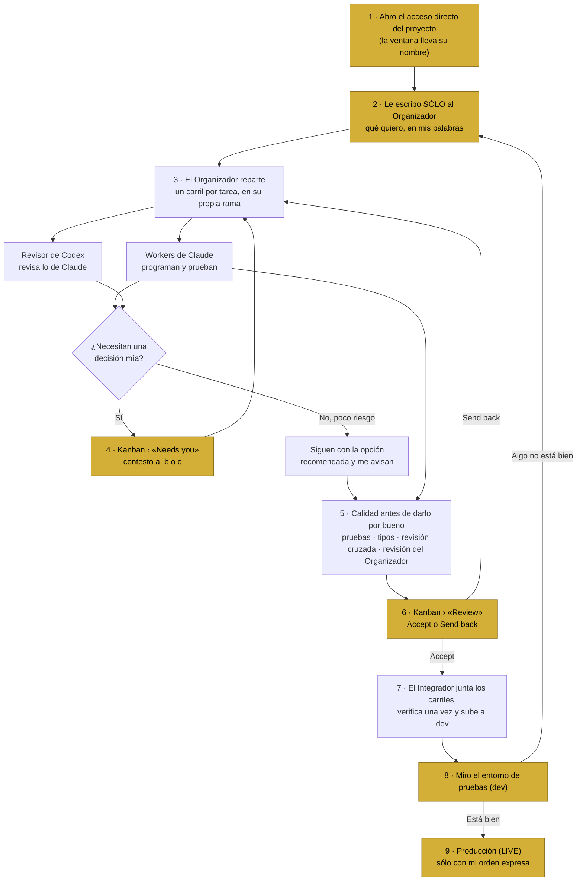
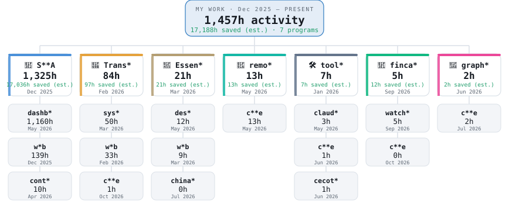

# Hi, I’m Vlad Cioca 👋

## Who am I?

I’m the CEO at SAVA Logistic, based in Castellar del Vallès. Background in Business Administration (logistics focus) and hands-on experience leading international transport operations, customer retention, and issue resolution in the logistics sector. 

## What am I currently working on?

* Building and scaling **n8n automations** (agentic workflows, ops + marketing pipelines, reporting, and integrations).

## What tools do I use?

* **Automation / Agents:** n8n, Antigravity
* **Dev:** Visual Studio Code
* **LLMs:** Claude, Gemini
* **Data / Backend:** Supabase
* **Ops stack:** Google Workspace

## How to reach me

* **WhatsApp:** [+34627259871](https://wa.me/34627259871)
* **Email:** [vlad.cioca@savaexpress.com](mailto:vlad.cioca@savaexpress.com)

<!--
**xRyUxSama/xRyUxSama** is a ✨ _special_ ✨ repository because its `README.md` (this file) appears on your GitHub profile.

Here are some ideas to get you started:

- 🔭 I’m currently working on ...
- 🌱 I’m currently learning ...
- 👯 I’m looking to collaborate on ...
- 🤔 I’m looking for help with ...
- 💬 Ask me about ...
- 📫 How to reach me: ...
- 😄 Pronouns: ...
- ⚡ Fun fact: ...
-->

## 🧭 Cómo trabajo con AgentMux (varias IA, un solo chat)

Cada proyecto se abre en su propia ventana de AgentMux. Yo sólo hablo con su **Organizador**: él reparte el trabajo entre
las IA (Claude programa, Codex revisa), me pregunta por el Kanban y nada llega a producción sin mi orden.

En dorado, lo que hago yo. Todo lo demás lo hacen los agentes.

**Lo que uso cada día**

| Necesito | Dónde |
|---|---|
| Hablar con el proyecto | el panel del Organizador, y sólo ese |
| Ver qué me están preguntando | **Kanban** en la barra de arriba, columna «Needs you» |
| Ver a todos los agentes de un vistazo | **Swarm** (también para mandar un mensaje a varios a la vez) |
| Que no se paren a cada paso | **Supervisor** en *Steady* para los organizadores |
| Dictar en vez de escribir | `Ctrl+Shift+V` (en local, el audio no sale del PC) |
| Cambiar de panel | `Ctrl+Shift+1…9` · `F6` |

**Reglas que no se saltan**

- Una pregunta de dinero, permisos, datos de personas o producción **siempre espera mi respuesta**.
- Ningún agente sube a producción; el Integrador sólo sube a dev, y a LIVE con mi orden.
- Si cambio la configuración de un agente (instrucciones o herramientas), para que la cargue: **Stop** en el Swarm →
  cerrar su panel → abrirlo desde su tarjeta en «My Agents».

<!-- claude-tracker:start -->
## 🌳 What I've built

<picture>
  <source media="(prefers-color-scheme: dark)" srcset="assets/work-tree-dark.svg">
  
</picture>

Auto-generated by my tracker · all-time AI session + estimated Git hours · parallel sessions add up · savings estimated · names masked · updated 2026-10-30
<!-- claude-tracker:end -->
